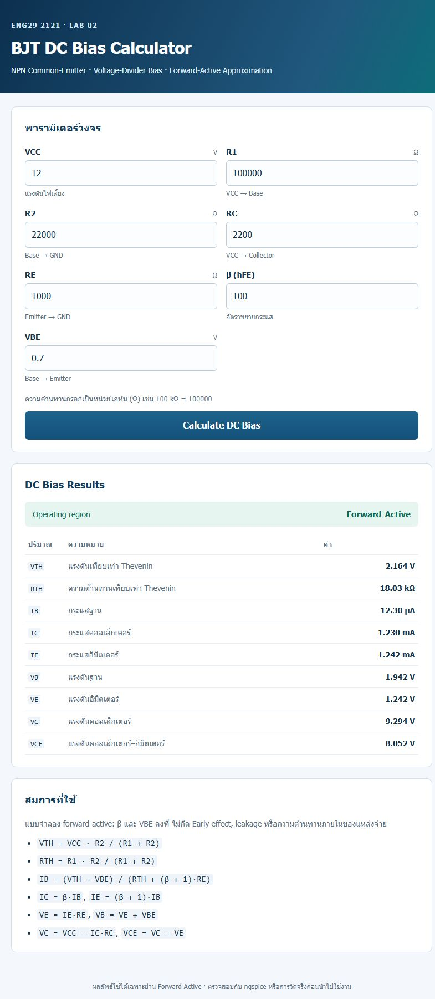

# Validation — engineering check

## Independent hand calculation

Inputs: VCC = 12 V, R1 = 100 kΩ, R2 = 22 kΩ, RC = 2.2 kΩ, RE = 1 kΩ,
β = 100, VBE = 0.70 V.

Step by step, without using the application:

1. `VTH = 12 × 22 000 / (100 000 + 22 000) = 2.1639 V`
2. `RTH = 100 000 × 22 000 / 122 000 = 18 032.79 Ω`
3. `IB = (2.1639 − 0.70) / (18 032.79 + 101 × 1 000) = 12.2986 µA`
4. `IC = 100 × 12.2986 µA = 1.22986 mA`
5. `IE = 101 × 12.2986 µA = 1.24216 mA`
6. `VE = 1.24216 mA × 1 kΩ = 1.2422 V`
7. `VB = 1.2422 + 0.70 = 1.9422 V`
8. `VC = 12 − 1.22986 mA × 2.2 kΩ = 9.2943 V`
9. `VCE = 9.2943 − 1.2422 = 8.0522 V`

Sanity checks: `IE = IB + IC` (1.2422 = 0.0123 + 1.2299 mA), `VTH > VBE`
(2.164 > 0.7, so not cut off), `VCE = 8.05 V` (far from saturation).

## Application output

| Quantity | Hand calculation | App output |
|---|---|---|
| VTH | 2.1639 V | 2.164 V |
| RTH | 18 032.79 Ω | 18.03 kΩ |
| IB | 12.2986 µA | 12.30 µA |
| IC | 1.22986 mA | 1.230 mA |
| IE | 1.24216 mA | 1.242 mA |
| VB | 1.9422 V | 1.942 V |
| VE | 1.24216 V | 1.242 V |
| VC | 9.2943 V | 9.294 V |
| VCE | 8.0522 V | 8.052 V |

Agreement is within display rounding (3 decimals). Region reported:
Forward-Active.

## Boundary behaviour

| Case | Input | Expected | Observed |
|---|---|---|---|
| Cutoff | R2 = 1 kΩ → VTH = 0.119 V ≤ VBE | region Cutoff, IC = 0, VCE = VCC, warning | matches |
| Cutoff boundary | R1 = 7.5 kΩ, R2 = 500 Ω, VBE = 0.75 V → VTH = VBE | treated as Cutoff (`<=`) | matches |
| Near cutoff | R2 = 6.242 kΩ → VTH − VBE = 5 mV | active + near-cutoff warning | matches |
| Saturation | R1 = R2 = 10 kΩ, RC = 20 kΩ → VCE < 0 | region Saturation, values struck through, warning | matches |
| Near saturation | RC = 8.2 kΩ → VCE ≈ 0.67 V | active + near-saturation warning | matches |
| R1 = 0 | invalid | "ต้องมากกว่า 0", no result | matches |
| VCC = "abc" | non-numeric | "ต้องเป็นตัวเลข", no result | matches |
| Missing field | empty input | "กรุณากรอกค่านี้" | matches |
| NaN / inf / 1e300 | out of range | rejected by the finite/bounds check, no `inf` cell | matches |
| Huge but valid | R1 = 1e12 Ω | computes finite values | matches |

## Second, independent circuit

VCC = 15 V, R1 = 47 kΩ, R2 = 10 kΩ, RC = 3.3 kΩ, RE = 1 kΩ, β = 150,
VBE = 0.70 V.

Hand calculation: VTH = 2.6316 V, RTH = 8 245.6 Ω, IB = 12.1296 µA,
IC = 1.81943 mA, IE = 1.83156 mA, VE = 1.8316 V, VB = 2.5316 V,
VC = 8.9959 V, VCE = 7.1643 V. The application matches, which shows the result
is genuinely computed rather than copied from the first case.

## Automated tests

```
python -m unittest discover -s tests -v
Ran 21 tests — OK
```

- `tests/test_dc_bias.py` — 13 tests: two hand-calculated operating points,
  Kirchhoff/Ohm consistency, cutoff, cutoff boundary (`VTH == VBE`),
  near-cutoff, saturation, near-saturation, and five validation rules
  (zero/negative, non-positive β and VCC, VBE ≥ VCC, NaN/inf/out-of-range).
- `tests/test_web.py` — 8 tests: GET form, POST calculation, recomputation for
  a different circuit (fails if the template hard-codes numbers), zero
  resistance, non-numeric, missing field, cutoff, and saturation rendering.



Screenshot of the reference case computed by the running Flask app.

## Limitations acknowledged

The model assumes constant β and VBE and ignores Early effect, leakage,
temperature and source resistance. Results in cutoff or saturation are not
physical predictions of this model, and the UI says so rather than presenting
them as valid.
