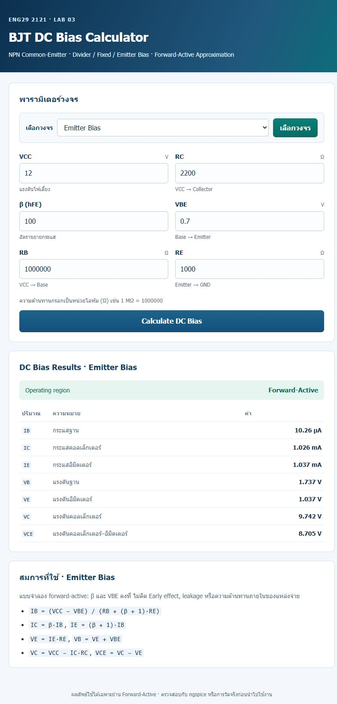
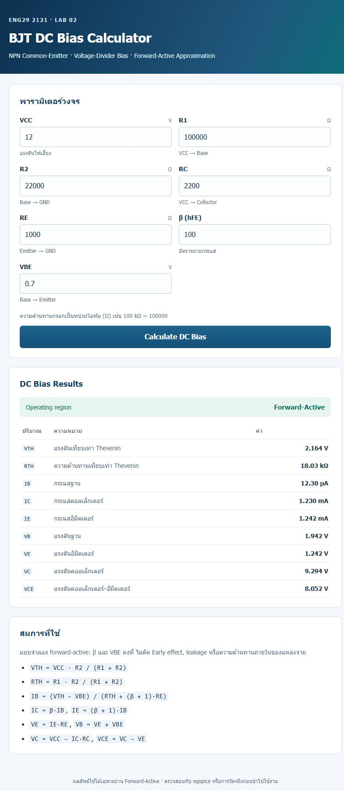

# Validation — engineering check

## Independent hand calculation

Inputs: VCC = 12 V, R1 = 100 kΩ, R2 = 22 kΩ, RC = 2.2 kΩ, RE = 1 kΩ,
β = 100, VBE = 0.70 V.

Step by step, without using the application:

1. `VTH = 12 × 22 000 / (100 000 + 22 000) = 2.1639 V`
2. `RTH = 100 000 × 22 000 / 122 000 = 18 032.79 Ω`
3. `IB = (2.1639 − 0.70) / (18 032.79 + 101 × 1 000) = 12.2986 µA`
4. `IC = 100 × 12.2986 µA = 1.22986 mA`
5. `IE = 101 × 12.2986 µA = 1.24216 mA`
6. `VE = 1.24216 mA × 1 kΩ = 1.2422 V`
7. `VB = 1.2422 + 0.70 = 1.9422 V`
8. `VC = 12 − 1.22986 mA × 2.2 kΩ = 9.2943 V`
9. `VCE = 9.2943 − 1.2422 = 8.0522 V`

Sanity checks: `IE = IB + IC` (1.2422 = 0.0123 + 1.2299 mA), `VTH > VBE`
(2.164 > 0.7, so not cut off), `VCE = 8.05 V` (far from saturation).

## Application output

| Quantity | Hand calculation | App output |
|---|---|---|
| VTH | 2.1639 V | 2.164 V |
| RTH | 18 032.79 Ω | 18.03 kΩ |
| IB | 12.2986 µA | 12.30 µA |
| IC | 1.22986 mA | 1.230 mA |
| IE | 1.24216 mA | 1.242 mA |
| VB | 1.9422 V | 1.942 V |
| VE | 1.24216 V | 1.242 V |
| VC | 9.2943 V | 9.294 V |
| VCE | 8.0522 V | 8.052 V |

Agreement is within display rounding (3 decimals). Region reported:
Forward-Active.

## Boundary behaviour

| Case | Input | Expected | Observed |
|---|---|---|---|
| Cutoff | R2 = 1 kΩ → VTH = 0.119 V ≤ VBE | region Cutoff, IC = 0, VCE = VCC, warning | matches |
| Cutoff boundary | R1 = 7.5 kΩ, R2 = 500 Ω, VBE = 0.75 V → VTH = VBE | treated as Cutoff (`<=`) | matches |
| Near cutoff | R2 = 6.242 kΩ → VTH − VBE = 5 mV | active + near-cutoff warning | matches |
| Saturation | R1 = R2 = 10 kΩ, RC = 20 kΩ → VCE < 0 | region Saturation, values struck through, warning | matches |
| Near saturation | RC = 8.2 kΩ → VCE ≈ 0.67 V | active + near-saturation warning | matches |
| R1 = 0 | invalid | "ต้องมากกว่า 0", no result | matches |
| VCC = "abc" | non-numeric | "ต้องเป็นตัวเลข", no result | matches |
| Missing field | empty input | "กรุณากรอกค่านี้" | matches |
| NaN / inf / 1e300 | out of range | rejected by the finite/bounds check, no `inf` cell | matches |
| Huge but valid | R1 = 1e12 Ω | computes finite values | matches |

## Second, independent circuit

VCC = 15 V, R1 = 47 kΩ, R2 = 10 kΩ, RC = 3.3 kΩ, RE = 1 kΩ, β = 150,
VBE = 0.70 V.

Hand calculation: VTH = 2.6316 V, RTH = 8 245.6 Ω, IB = 12.1296 µA,
IC = 1.81943 mA, IE = 1.83156 mA, VE = 1.8316 V, VB = 2.5316 V,
VC = 8.9959 V, VCE = 7.1643 V. The application matches, which shows the result
is genuinely computed rather than copied from the first case.

## Lab 03 — hand derivation for the two new circuits

Common to A2–A5: VCC = 12 V, RC = 2.2 kΩ, β = 100, VBE = 0.70 V.

### Fixed bias (A2: RB = 1 MΩ)

1. `IB = (VCC − VBE) / RB = (12 − 0.70) / 1 000 000 = 11.30 µA`
2. `IC = β·IB = 100 × 11.30 µA = 1.1300 mA`
3. `IE = (β + 1)·IB = 101 × 11.30 µA = 1.1413 mA`
4. `VE = 0 V` — the emitter is tied directly to ground; there is no RE
5. `VB = VE + VBE = 0.7000 V`
6. `VC = VCC − IC·RC = 12 − 1.1300 mA × 2.2 kΩ = 9.5140 V`
7. `VCE = VC − VE = 9.5140 V`

### Emitter bias (A3: RB = 1 MΩ, RE = 1 kΩ)

1. `RB + (β + 1)·RE = 1 000 000 + 101 × 1 000 = 1 101 000 Ω`
2. `IB = (VCC − VBE) / 1 101 000 = 11.30 / 1 101 000 = 10.2634 µA`
3. `IC = 100 × 10.2634 µA = 1.02634 mA`
4. `IE = 101 × 10.2634 µA = 1.03660 mA`
5. `VE = IE·RE = 1.03660 mA × 1 kΩ = 1.03660 V`
6. `VB = VE + VBE = 1.73660 V`
7. `VC = 12 − 1.02634 mA × 2.2 kΩ = 9.74205 V`
8. `VCE = VC − VE = 8.70545 V`

### Emitter bias with RE doubled (A4: RE = 2 kΩ)

1. `RB + (β + 1)·RE = 1 000 000 + 101 × 2 000 = 1 202 000 Ω`
2. `IB = 11.30 / 1 202 000 = 9.4010 µA`
3. `IC = 0.94010 mA`, `IE = 0.94950 mA`
4. `VE = 0.94950 mA × 2 kΩ = 1.8990 V`, `VB = 2.5990 V`
5. `VC = 12 − 0.94010 mA × 2.2 kΩ = 9.93178 V`
6. `VCE = 9.93178 − 1.8990 = 8.03278 V`

`IC` falls from 1.02634 mA to 0.94010 mA when RE doubles: the denominator gains
another `(β + 1)·1 kΩ = 101 kΩ` of reflected emitter resistance, so base current
and therefore collector current decrease.

The divider value (A1) is unchanged from Lab 02: `compute_divider_bias()` adapts
the untouched `compute_dc_bias()` result to the shared dict, so all nine rows
stay identical.

## Lab 03 — browser acceptance cases A1–A5

Tolerance: `±0.01 mA` for IC and `±0.02 V` for VCE. Method: OpenCode Browser
(Playwright MCP is not configured on this machine). The expected values below
were derived by hand above and must be checked and owned by the student before
submission. Observed values were read from a fresh accessibility snapshot after
each real form submission against `http://127.0.0.1:5000/`.

| Case | Mode | Inputs (Ω unless noted) | Expected IC | Expected VCE / message | Observed (with units) | Method | Status | Evidence |
|---|---|---|---|---|---|---|---|---|
| A1 | Divider | R1=100000, R2=22000, RE=1000; VCC=12 V, RC=2200, β=100, VBE=0.7 V | 1.2299 mA | 8.0522 V | `IC 1.230 mA`, `VCE 8.052 V` — all nine rows match the supplied screenshot (VTH 2.164 V, RTH 18.03 kΩ, IB 12.30 µA, IC 1.230 mA, IE 1.242 mA, VB 1.942 V, VE 1.242 V, VC 9.294 V, VCE 8.052 V) | OpenCode Browser | PASS | post-submit snapshot; server HTTP 200 |
| A2 | Fixed | RB=1000000; VCC=12 V, RC=2200, β=100, VBE=0.7 V | 1.1300 mA | 9.5140 V | `IC 1.130 mA`, `VCE 9.514 V` (region Forward-Active, VE = 0 so VC = VCE) | OpenCode Browser | PASS | post-submit snapshot; server HTTP 200 |
| A3 | Emitter | RB=1000000, RE=1000; VCC=12 V, RC=2200, β=100, VBE=0.7 V | 1.02634 mA | 8.70545 V | `IC 1.026 mA`, `VCE 8.705 V` | OpenCode Browser | PASS | post-submit snapshot + `screenshots/lab03-emitter.jpeg` |
| A4 | Emitter | RB=1000000, RE=2000; VCC=12 V, RC=2200, β=100, VBE=0.7 V | 0.94010 mA | 8.03278 V | `IC 0.940 mA`, `VCE 8.033 V` (8.03278 rounds to 3 decimals; within tolerance) | OpenCode Browser | PASS | post-submit snapshot; RE re-run note below |
| A5 | Fixed | RB=0; VCC=12 V, RC=2200, β=100, VBE=0.7 V | n/a (rejected) | `ต้องมากกว่า 0`, no result | `ตรวจสอบข้อมูลอีกครั้ง` + `RB: ต้องมากกว่า 0`; no `Operating region` badge and no results table | OpenCode Browser | PASS | post-submit snapshot with `RB = 0` |

All five cases pass their criterion: for A1–A4 the observed IC is within
`±0.01 mA` and VCE within `±0.02 V` of the hand-derived expectation; for A5 the
form rejects the input and renders no result rather than dividing by zero.

### Selector behaviour (why RB can appear to be missing)

The mode `<select>` submits by `GET /?mode=...` only when the adjacent
**เลือกวงจร** button is pressed — deliberately no JavaScript, per `AGENTS.md`.
Selecting a different option without pressing the button leaves the previous
form visible, so switching from Divider to Fixed looks as if RB disappeared.
This was reproduced in OpenCode Browser: after selecting "Fixed Bias" the
fields were still `VCC, RC, β, VBE, R1, R2, RE`; after pressing the button the
URL became `?mode=fixed` and the fields became `VCC, RC, β, VBE, RB`. The
selector label is now **โหมดวงจร** (distinct from the button) and a hint below
it states that the button must be pressed and that RB appears only in
Fixed/Emitter. `tests/test_web.py` pins that hint so it cannot regress.

### Browser evidence



Screenshot of case A3 (Emitter Bias, RB = 1 MΩ, RE = 1 kΩ) computed by the
running Flask app in OpenCode Browser: `IC 1.026 mA`, `VCE 8.705 V`,
Operating region **Forward-Active**. The dropdown selector shows the active
mode and all six emitter input fields are visible.

### How `RE` travels from the form field to `compute_emitter_bias`

The value crosses four layers; no physics is computed in the template.

1. The user types `1000` into the `RE Ω` textbox. The POST form sends
   `name="re"` together with the hidden `name="mode"` set to `emitter`.
2. `app.py` `calculate()` reads that mode. `fields_for_mode("emitter")`
   returns `COMMON_FIELDS + ("rb", "re")`, so `_read_form()` reads exactly
   `re` (and never `r1`/`r2`, which belong to the divider circuit).
3. `_read_form()` converts the raw string with `float(raw)` into
   `values["re"] = 1000.0`; `validate_mode()` then checks it is numeric,
   positive and within `MAX_RESISTANCE` before any calculation is attempted.
4. `compute_emitter_bias(values)` reads `re = values["re"]` and uses it in
   `ib = drive_v / (rb + (beta + 1.0) * re)` and `ve = ie * re`.

Case A4 was re-run in the browser after changing only `RE` from 1000 to 2000 Ω:
`IC` fell from 1.026 mA to 0.940 mA and `VCE` from 8.705 V to 8.033 V. That
confirms the field is genuinely consumed by the calculation and is not a value
copied into the template.

## Automated tests

```
.\.venv\Scripts\python.exe -m unittest discover -s tests -v
Ran 65 tests in 0.071s — OK
```

The original 39 Lab 02/03 tests are unchanged; 26 Lab 04 tests were added. The
full captured output is in [`test-log.txt`](test-log.txt) (UTF-8, no BOM).

- `tests/test_dc_bias.py` — 13 tests: two hand-calculated operating points,
  Kirchhoff/Ohm consistency, cutoff, cutoff boundary (`VTH == VBE`),
  near-cutoff, saturation, near-saturation, and five validation rules
  (zero/negative, non-positive β and VCC, VBE ≥ VCC, NaN/inf/out-of-range).
- `tests/test_lab03.py` — 7 tests: fixed bias hand calculation, emitter bias
  hand calculation, IC falling when RE increases, divider adapter keeping the
  shared result keys, unknown mode returning no fields, common fields present
  in every mode, and missing `rb` reported by `validate_mode`.
- `tests/test_web.py` — 19 tests: the original 8 (GET form, POST calculation,
  recomputation for a different circuit, zero resistance, non-numeric, missing
  field, cutoff, saturation) plus 11 mode tests (per-mode field lists, selector,
  hidden mode, fixed/emitter POST values, unknown mode, invalid/zero RB, no
  stale result after an error, and the hint explaining that the mode-change
  button must be pressed).

- `tests/test_plots.py` — 2 tests: SVG output is generated from the supplied
   data and contains no hard-coded result values.
- `tests/test_spice_engine.py` — 18 tests: input validation, netlist content,
   engine resolution/runner behaviour, and parsers checked against the real
   ngspice 47 logs kept in `tests/fixtures/`.
- `tests/test_toolchain.py` — 1 test: the bundled `.mod` file is present and
   labelled `UNVERIFIED`.
- `tests/test_web_simulator.py` — 5 tests: `/simulator` GET, `/simulate` POST
   success with provenance/SVG, parsing errors, engine-error status without a
   plot, and confirmation that the Lab 03 `/` route is unchanged.



Screenshot of the reference case computed by the running Flask app.

## Lab 04 — CE amplifier simulator (real ngspice evidence)

**Engine:** `** ngspice-47 : Circuit level simulation program` (console binary
`ngspice_con.exe`). **Model:** `CE_UNVERIFIED` from
`spice_models/ce_generic.mod` (`NPN(BF=100 VAF=100 IS=1E-14)`) — a generic
teaching model, explicitly marked UNVERIFIED in the UI and **not** checked by
an instructor. **Method:** OpenCode Browser against the live Flask app at
`http://127.0.0.1:5000/simulator`; Playwright MCP is not configured on this machine.
Values were read from a fresh accessibility snapshot / DOM text after each
real POST, not from unit-test fixtures. Numerical smoke runs were also made
through `spice_engine.simulate()` using the real binary.

Every observed SPICE number below came from a batch log written by ngspice
itself. The captured logs are kept as parser fixtures in `tests/fixtures/`
(`ngspice_dc_real.log`, `ngspice_ac_real.log`, `ngspice_tran_real.log`); they
are evidence of the engine's real output format, never engine results used by
the application at runtime.

| Case | Method | Input | Expected/Reference | Observed | Evidence | Status |
|---|---|---|---|---|---|---|
| B1 regression | OpenCode Browser | Lab 03 divider: VCC 12 V, R1 100 kΩ, R2 22 kΩ, RC 2.2 kΩ, RE 1 kΩ, β 100, VBE 0.7 V | A1 hand calculation: IC 1.2299 mA, VCE 8.0522 V, Forward-Active | `IC 1.230 mA`, `VCE 8.052 V`, region `Forward-Active`; all nine rows as in A1 | post-submit snapshot at `/`; full-page screenshot captured | PASS |
| B2 DC SPICE | OpenCode Browser | defaults (same divider values), Analysis = DC | five labelled SPICE values with units, real `.op`, separate analytical panel | Engine status `SUCCESS`; `VB 1.949 V`, `VE 1.289 V`, `VC 9.189 V`, `VCE 7.900 V`, `IC 1.278 mA`; analytical panel separately shows `IC 1.230 mA`, `VCE 8.052 V` | snapshot of `.sim-results` and `.sim-analytical`; provenance line shows ngspice-47 + CE_UNVERIFIED | PASS |
| B3 change RE only | OpenCode Browser | RE 1000 → 2000 Ω, all other fields unchanged | IC must fall, VE and VCE must change | `VE 1.405 V`, `VC 10.469 V`, `VCE 9.065 V`, `IC 0.696 mA` (from 1.278 mA) | snapshot after re-submit; form value `re=2000` | PASS |
| B4 Bode axes/units | OpenCode Browser | Analysis = AC (RE 2000 Ω retained from B3), defaults otherwise | log-frequency axis in Hz, gain in dB, phase in deg, legend, real points | `Points 141`, `Gain low -8.28 dB`, `Gain high -1.14 dB`, `Phase low -83.8 deg`, `Cutoff ไม่พบในช่วงสแกน`; SVG text includes `Frequency (Hz)`, `Gain (dB)`, `Phase (deg)`, `Vin`/`Vout`-style legend | snapshot + SVG text nodes (20) | PASS |
| B5 waveform + inversion | OpenCode Browser | Analysis = TRAN, RE restored to 1000 Ω, source 10 mV, 1 kHz | non-empty waveform, Vin 0.0100 V, inverted phase | `Samples 508`, `Vin peak 0.0100 V`, `Vout peak 0.0175 V`, `Phase inverted`; axes `Time (ms)`, `Voltage (V)`, legend `Vin`, `Vout` | snapshot after re-submit; form `re=1000, source_peak_v=0.01, source_freq_hz=1000` | PASS |
| B6 amplitude + frequency change | OpenCode Browser | same as B5 then source 50 mV, 2 kHz | Vout peak scales about 5×; time window halves | `Vin peak 0.0500 V`, `Vout peak 0.0875 V` (5× B5), `Phase inverted`; plot x-axis 0–2.5 ms (B5: 0–5 ms), 508 samples | snapshot + `docs/captures/lab04-b6-tran-changed.png` | PASS |
| B7 invalid input | OpenCode Browser | RE = 0, TRAN mode | Thai validation message, no fabricated result or plot | `ตรวจสอบข้อมูลอีกครั้ง` / `re: ต้องมากกว่า 0`; no `.plot svg`, no engine-status badge | snapshot of `.alert` and DOM query for plot | PASS |
| B8 responsive / mode switching | Playwright + Chrome headless (real 1280×800 / 390×844 viewports), Impeccable `shot` + URL detector, OpenCode Browser for mode switching | desktop and mobile shells; switch DC → AC → TRAN with real runs | no clipped buttons, graphs or units | Desktop (1440 px viewport in the in-app browser): page `scrollWidth 1423` < `innerWidth 1440`; `Run ngspice` button right edge 626 px; `.plot` `scrollWidth 516 / clientWidth 509` with `overflow-x: auto`; SVG 500 px wide; tick and legend computed 13 px; units visible in every mode (`1.949 V`, `1.278 mA`, `4.86 dB`, `0.0175 V`). Mobile 390×844 detector after polish: `[]` (no findings; before polish: 4 primary + 2 advisory). Before/after captures: `docs/captures/before/`, `docs/captures/after/`; results-state `docs/captures/lab04-b8-after-tran-desktop.png`; **new Playwright/Chrome captures after real runs:** `docs/captures/lab04-b8-desktop-tran.png` (1280×2278) and `docs/captures/lab04-b8-mobile-tran.png` (390×3936, `innerWidth 390`, `scrollWidth 390`, `.plot` `overflow-x: auto`, values `508 samples` / `Vin peak 0.0100 V` / `Vout peak 0.0175 V` / `inverted`) | screenshots + detector JSON + DOM/CSS measurements | PASS |

### Engine and parsing notes (why the numbers are trustworthy)

- ngspice 47 suppresses `.print` tables and the `.op` summary when `-r` is
  supplied (`.print line ignored since rawfile was produced.`). The adapter
  therefore runs the batch deck without `-r` and parses the human-inspectable
  log; no `.raw` binary is read. `RunResult.raw_path` is kept for interface
  compatibility and is `None` in this mode.
- `.print op v(vc,ve)` is not accepted by this build; the netlist uses
  `v(vc)-v(ve)`. Collector current comes from the real `.op` BJT block
  (`ic 0.00127819` A → 1.278 mA), not from an unavailable `q1#branch` vector.
- `.print ac` writes one table per vector group, repeated across pages. The
  parser merges the `vout` and `vin` tables by frequency before computing
  gain/phase. This build reports `vp()` in **radians** (verified with an RC
  low-pass: −0.7854 rad at its −3 dB point), so phase is converted to degrees.
- `.tran 0 <tstop> 0 <tmax>` is rejected by ngspice 47 (`TSTEP is invalid`);
  the netlist uses a positive first step equal to `tmax`.

### Impeccable design audit (Task 8)

Tool: Impeccable skill installed for OpenCode (`npx impeccable install -y --project
--providers=opencode`), engine v0.1.27. The critique used two isolated
sub-agents (A = design review, B = detector/browser evidence); the snapshot is
committed at
[`impeccable-critique-2026-11-24.md`](impeccable-critique-2026-11-24.md)
(the original tool output lives at
`.impeccable/critique/2026-11-24T11-00-57Z__127-0-0-1-simulator.md` on the
development machine). Design Health Score before polish: **18/40 (Poor)**,
Operate mode, all ten heuristics applied.

- Detector before: 1280×800 → 4 primary findings (`kicker-above-heading`,
  `nested-cards` ×2, `first-viewport-column-overflow`); 390×844 → 4 primary +
  2 advisory (nav contrast 4.4:1, unbalanced heading); static markup → 1
  likely false positive because the detector could not read the Jinja
  `url_for` stylesheet. After polish: 390×844 → `[]`; `--changed` → only
  `side-tab` (pre-existing `.alert` border-left shared with Lab 03) and the
  same `flat-type-hierarchy` false positive.
- Applied (UI files only): removed the banned kicker from the simulator header
  and moved the course/lab label into the subtitle; promoted the UNVERIFIED
  badge above provenance at 13 px with a Thai next-action line; decluttered
  `.analysis-select` and simulator-only empty states; made the plot container
  scroll horizontally with a 500 px minimum SVG width and 13–14 px tick,
  legend and axis text; darkened the hero gradient and whitened nav links;
  added `text-wrap` to the subtitle and analytical heading.
- Rejected as out of Task 8 scope or against the plan's constraints: hiding
  source/coupling inputs for `.op` (would change form submission), mapping raw
  error keys and engine-failure reasons in `app.py`, a dual-axis legend cue in
  `plots.py`, restructuring the stacked comparison panels, and anything that
  hard-codes values, replaces real plots, changes units or moves physics into
  Jinja.
- Unresolved: 13-input cognitive wall; no reset or re-run-last; raw `re:`
  error keys and a bare engine-failure message; Bode dual-axis cue. The earlier
  mobile visual gap is now closed: Playwright + Chrome were installed in the
  local venv and captured a 390×844 viewport with a real TRAN result
  (`docs/captures/lab04-b8-mobile-tran.png`), so B8 no longer relies only on the
  detector scan. Sub-agent B's browser calls failed with `[browser.disconnected]`
  in the child session; the parent browser and later Playwright runs carried
  the B8 verification instead. No visual overlay was injected, so none is
  claimed.

### Known limitations

- The generic BJT model is UNVERIFIED; SPICE and analytical DC results differ
  (IC 1.278 mA vs 1.230 mA) because ngspice uses a real BJT model with Early
  effect, while `dc_bias.py` assumes constant β and VBE. The UI keeps them in
  separate panels and says the comparison is illustrative only.
- The −3 dB cutoff is reported only when an absolute −3 dB crossing exists in
  the 1 Hz–10 MHz sweep; for the unbypassed reference circuit the sweep never
  falls below 0 dB, so the UI says `ไม่พบในช่วงสแกน` instead of inventing a value.
- The Flask process resolves `ngspice_con` from PATH or the standard Windows
  `%LOCALAPPDATA%\ngspice\Spice64\bin` install location; if neither is present
  the UI reports `ENGINE NOT AVAILABLE` rather than showing numbers.
- Student must independently check and own every case above before submission.

## Limitations acknowledged

The model assumes constant β and VBE and ignores Early effect, leakage,
temperature and source resistance. Results in cutoff or saturation are not
physical predictions of this model, and the UI says so rather than presenting
them as valid.

## Lab 04 — final verification and submission record

- **Environment verified:** Python 3.15.2, Flask 3.1.3, ngspice 47
  (`** ngspice-47 : Circuit level simulation program`).
- **Model source:** `spice_models/ce_generic.mod`, name `CE_UNVERIFIED`,
  `NPN(BF=100 VAF=100 IS=1E-14)`; generic teaching model, not instructor-verified.
  Replacing it with a verified model is a student-owned step before any claim
  of engineering accuracy.
- **Local URLs:** <http://127.0.0.1:5000/> (unchanged Lab 03 app) and
  <http://127.0.0.1:5000/simulator> (Lab 04).
- **Tests:** full suite re-run fresh before commit — `Ran 65 tests`, `OK`,
  exit code 0; log saved as UTF-8 in `docs/test-log.txt`.
  Original 39 tests unchanged; 26 Lab 04 tests added.
- **UI evidence:** before/after screenshots in `docs/captures/`, browser graph
  captures, and the committed Impeccable critique snapshot
  `docs/impeccable-critique-2026-11-24.md`. A final live re-check ran DC, AC and
  TRAN in the browser: all three returned `SUCCESS` with real parsed values and
  SVG plots, and no console errors. The B1–B8 screenshots are reproducible with
  `docs/capture-evidence.py` (`pip install playwright`, Chrome installed, Flask
  running on port 5000).
- **Browser cases:** B1–B8 PASS. Playwright/Chrome captures cover every case in
  `docs/captures/` (`lab04-b1-*` … `lab04-b7-*`, plus desktop and 390 px mobile
  B8 screenshots after real runs). Student must re-check every case
  independently before submission.
- **Repository audit:** no `.venv/`, `.env`, credentials or large raw run files
  staged; `.opencode/` tool artifacts and the plan/spec files are intentionally
  left unstaged.
- **Submission commit SHA:** `1e72eaa2c86b1017064ff2c62d1fdfc80290df3d`
  (commit `docs: finalise Lab 04 reproduction and validation record`, pushed to `main`).
- **Commit URL:**
  <https://github.com/GTThanakrit/BJT-DC-Bias-Web-App/commit/1e72eaa2c86b1017064ff2c62d1fdfc80290df3d>.
- `docs/reflection.md` placeholders are intentionally untouched; the student
  must write the reflection in their own words before submission.
